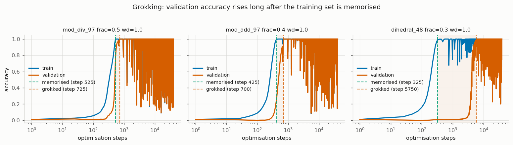
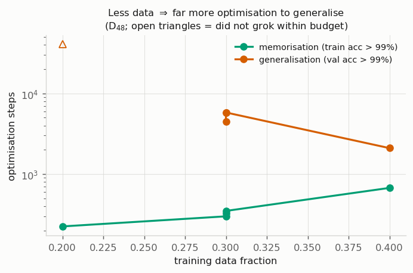
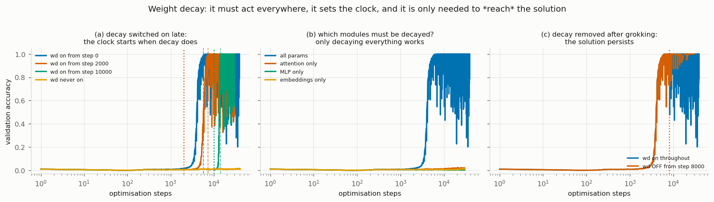
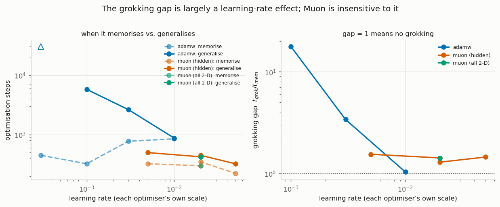
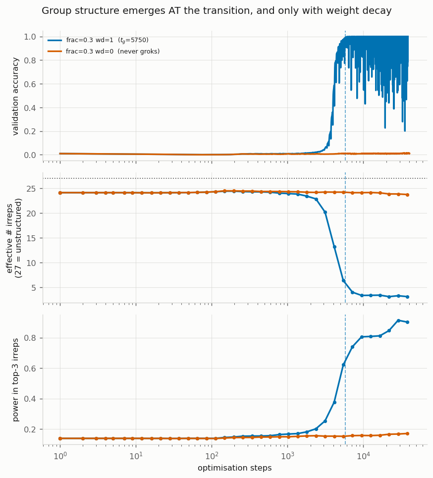
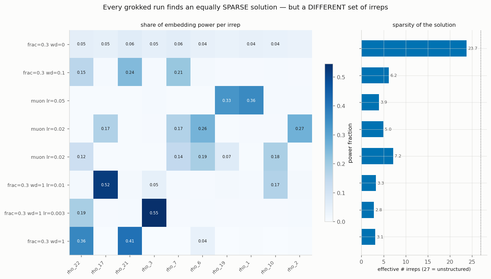
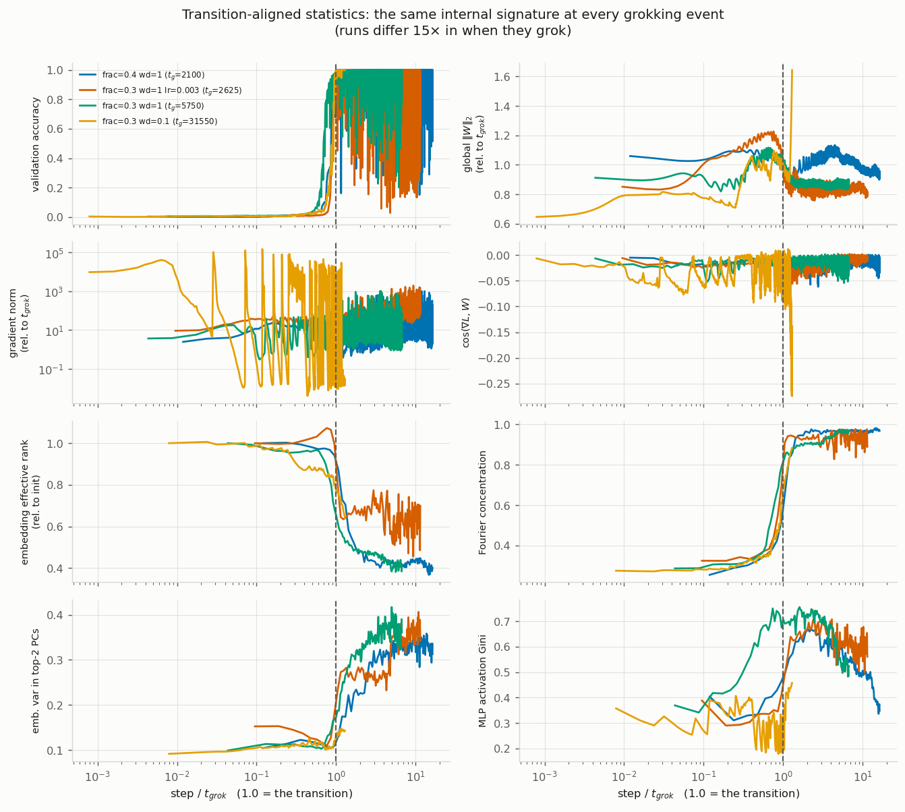
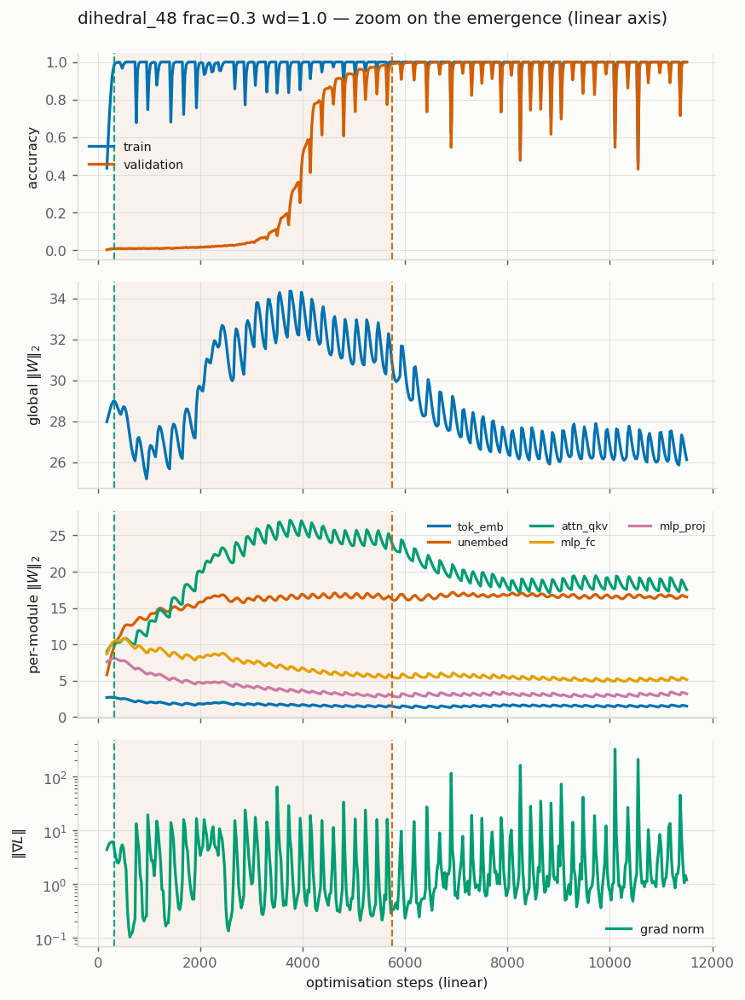
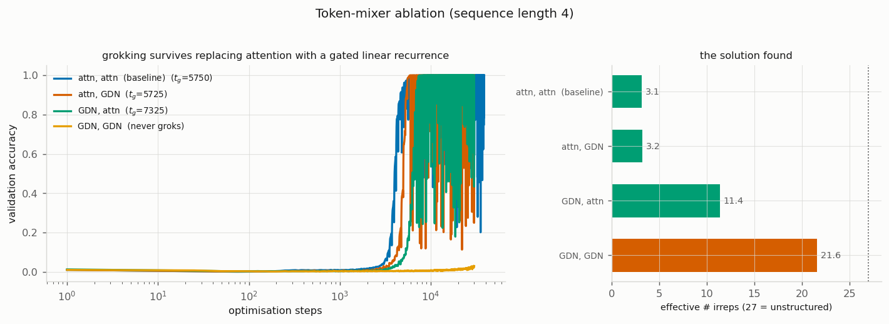

*A mechanistic study of grokking, reproducing [Power et al. (2022)](https://arxiv.org/abs/2201.02177) and extending it to a group they never used.*

## The phenomenon

Grokking is a simple but strange fact about training. Take a small transformer and train it on a table of algebraic equations, holding some rows out. Within a few hundred steps it fits the training set perfectly and the training loss goes flat, while held-out accuracy is still stuck at chance. It looks like the model has memorised the answers and has nothing left to learn.

Keep training anyway. Thousands of steps later, long after the loss stopped moving, held-out accuracy climbs off the floor to 100%. The model that had memorised the table has started to compute the answer instead. [Power et al. (2022)](https://arxiv.org/abs/2201.02177) named this grokking and showed it on modular arithmetic and the symmetric group S₅.

We measure it with one number, the **grokking gap**: the step where the model first reaches 99% on the training data, divided by the step where it first reaches 99% on held-out data. A gap of 1 is ordinary training, where the model learns and generalises at the same time. A gap of 17 means it sat at chance on held-out data for seventeen times as long as it took to memorise.

This post asks two things: what controls the size of the gap, and what actually changes inside the network at the jump.

## A new task: composing the symmetries of a polygon

[Power et al. (2022)](https://arxiv.org/abs/2201.02177) demonstrated grokking on modular arithmetic and on the symmetric group S₅. We wanted a task that appears nowhere in their list, so that any grokking we saw would be a genuine reproduction of the *effect* rather than a re-run of their *setup*.

The task is composition in the **dihedral group D₄₈**, the symmetry group of a regular 48-sided polygon. Its elements are the rotations and reflections `{r^i s^f}`, with the group law (following from `sr = r⁻¹s`)

$$
(i, f) \cdot (j, g) \;=\; \bigl(\, i + (-1)^f\, j \ \bmod n,\ \ f \oplus g \,\bigr).
$$

At `n = 48` this gives 96 elements and 9216 equations, deliberately matched to the paper's 9409 so that dataset size is not a confound. Crucially, D₄₈ is **non-abelian**: the order of the two inputs matters, because `(-1)^f` flips the sign of the second operand's rotation whenever the first is a reflection. The paper notes this is the harder regime for a transformer. Structurally it is a semidirect product $\mathbb{Z}_{48} \rtimes \mathbb{Z}_2$, sitting between the modular-arithmetic tasks and the S₅ task the paper studied, duplicating neither.

The 96 group elements are presented to the network as 96 abstract symbols with no internal structure. It sees only a table of `<x> <op> <y> <=> <answer>` equations and must infer the entire group law from examples. The architecture is the paper's: a 2-layer, width-128, 4-head decoder-only transformer with 394,496 non-embedding parameters, trained with AdamW at lr 1e-3 and weight decay 1.0.

**It groks.** The network learns all 2765 training examples by step 325 while still scoring at chance (1/96 ≈ 0.010) on held-out ones, then jumps to perfect held-out accuracy at step 5750. A gap of **17.7×**, reproduced on a second seed (16.6×). Grokking is not an artefact of the specific tasks in the original paper.

## Whether it groks depends on how you train it

Here is the first thing that undercuts the folk framing of grokking as a property of a task. The *identical* dataset gives wildly different behaviour depending only on how much of the multiplication table you show the network.

Memorisation time is nearly flat in the training fraction (225 to 675 steps from 20% to 40% data), while generalisation time explodes:

| training fraction | t_memorise | t_grok | gap |
|---|---|---|---|
| 20% | 225 | never (within 40k steps) | n/a |
| 30% | 325 | 5750 | **17.7×** |
| 40% | 675 | 2100 | 3.1× |

This is the paper's central data-efficiency trend, reproduced on a task they never ran. But it also means the question "does model X grok on task Y" has no answer unless the training setup is specified too. Data fraction alone spans "no grokking at all" to "never generalises."

## Weight decay is the cause, not background regularisation

Weight decay is usually thought of as gentle pressure keeping weights small and discouraging overfitting. On this task it is the difference between generalising and never generalising, and it behaves less like a regulariser than like a **timer**.

**It is necessary.** Turn weight decay off and the network memorises at step 275 and then stays at chance validation accuracy through 40,000 steps. No grokking at all. At wd = 0.1 it groks, but only at step 31,550 (a 114× gap); at wd = 1.0, step 5750 (17.7×). The coefficient moves the transition time by roughly 6×.

**It starts a clock.** Train with wd = 0 and switch decay on at step N:

| decay switched on at | grokked at | steps *after* onset |
|---|---|---|
| 0 (baseline) | 5750 | 5750 |
| 2000 | 7325 | 5325 |
| 10000 | 14150 | 4150 |
| never | never (40k steps) | n/a |

Grokking follows decay onset by roughly 4000 to 5300 steps almost regardless of *when* you switch it on. The memorising solution is therefore a genuinely **stable attractor**: it persists indefinitely without decay, and decay dislodges it on a roughly fixed timescale. It is not an instant tip out of a shallow basin.

**It must act everywhere.** Restricting decay to a single module family, at the same coefficient:

| decayed modules | grokked? |
|---|---|
| all | yes (5750) |
| attention only | **never** |
| MLP only | **never** |
| embeddings only | **never** |

All three partial variants memorise and never generalise. This is notable because, as we will see below, the entire weight-norm rise during memorisation is carried by the attention matrices, yet decaying attention *alone* is insufficient. Whatever weight decay does, it is not simply "shrink the module that grew."

**But only to reach the solution, not to hold it.** Switch decay off at step 8000 (post-transition) and validation accuracy stays at 1.000 through 30k steps. Decay is needed to *find* the general solution, not to *maintain* it.

## Most of the delay is just the learning rate

This is the section where we had to reverse our own conclusion, so it comes with a warning label.

We first believed that Muon, a newer optimiser that orthogonalises the gradient with a Newton-Schulz iteration, had **abolished** grokking. It generalised almost immediately (gap 1.4×) where AdamW took 5750 steps (17.7×). That looked like a clean optimiser effect.

It was wrong. Muon's learning rate (0.02) and AdamW's (1e-3) are not on a common scale: Muon's update has roughly unit *spectral* norm while AdamW's has roughly unit *max-abs* norm, which is why Muon is normally run 10 to 50 times higher. Comparing one learning rate each confounds the update rule with the step size. So we swept both.

| optimiser | lr | t_memorise | t_grok | gap | stable at end? |
|---|---|---|---|---|---|
| AdamW | 3e-4 | 450 | not within 30k | >20× | yes |
| AdamW | 1e-3 | 325 | 5750 | **17.7×** | yes |
| AdamW | 3e-3 | 775 | 2625 | 3.4× | yes |
| AdamW | 1e-2 | 850 | 875 | **1.0×** | **no** (ends at 33% train acc) |
| Muon | 5e-3 | 325 | 500 | 1.5× | yes |
| Muon | 2e-2 | 350 | 450 | 1.3× | yes |
| Muon | 5e-2 | 225 | 325 | 1.4× | yes |

Three conclusions, in order of confidence:

1. **The gap is primarily a learning-rate phenomenon.** Plain AdamW spans 17.7× down to 1.0× over one order of magnitude in learning rate. The long plateau is mostly a symptom of taking small steps, not a fundamental obstacle to learning the rule. Any claim that some optimiser "removes grokking" must be checked against a learning-rate sweep of the baseline first.
2. **Muon's real advantage is robustness, not a lower floor.** It sits at 1.3 to 1.5× across a tenfold range in learning rate without tuning, whereas AdamW only reaches roughly 1× at lr 1e-2, and there it is unstable, ending at 33% train accuracy having previously hit 100%. Muon reaches a near-zero gap while staying stable, which AdamW did not manage at any learning rate we tried.
3. A useful side-observation: as the AdamW learning rate rises, `t_memorise` *increases* (325 to 850) while `t_grok` *falls* (5750 to 875). The two phases move in opposite directions, so the gap is not simply "everything happens faster."

The general lesson: it is very easy to attribute to a fancy new method something that a learning-rate sweep of the baseline would have explained.

## What actually changes at the jump

We now have knobs that control *when* grokking happens. The deeper question is *what* happens: what is physically different about the network's weights on either side of the jump? To answer that we need a way to look at the learned embedding and ask a single question, "how much of the group's structure is in here?" Here is how we built that measurement, in four steps.

**1. The problem the network faces.** The 96 symbols arrive with no structure attached. As far as the model can tell at initialisation, they are 96 unrelated tokens. A lookup table treats them exactly that way: it stores an answer for every `(x, y)` pair and never notices that the symbols are secretly the elements of a group. To generalise, the network has to *discover* that hidden structure and lay the symbols out in a geometry where the group operation becomes computable.

**2. What "group structure" means concretely.** For ordinary modular addition (an abelian group), the structured way to represent the integers is with Fourier features: place each integer on a circle using sines and cosines at a few frequencies, and addition becomes rotation. [Nanda et al. (2023)](https://arxiv.org/abs/2301.05217) showed that grokking on modular addition is exactly the network switching from a lookup table to a handful of these frequencies. D₄₈ is non-abelian, so plain sine waves do not apply. The correct generalisation is representation theory: every finite group comes with a canonical, finite set of building blocks called **irreducible representations** (irreps), the exact analogue of Fourier frequencies for a group that does not commute. D₄₈ has 27 of them. Any representation that respects the group's structure must be built out of these 27 pieces, and a representation that uses all 27 in equal measure has no structure at all. It is just a table.

**3. How we read off which irreps the network is using.** Take the trained token-embedding matrix: 96 symbols, each a 128-dimensional vector. Read it the other way, one embedding dimension at a time. Each of the 128 dimensions assigns one number to each of the 96 group elements, so each dimension *is a function on the group*. Representation theory (the group analogue of a Fourier transform) says any such function decomposes uniquely into contributions from the 27 irreps. Summing over all 128 dimensions, we compute what fraction $p_\rho$ of the embedding's total squared magnitude ("power") lands in each irrep $\rho$. We check this against Parseval's identity: the 27 fractions sum to 1.

**4. Collapsing that to one number.** The distribution $p_\rho$ over 27 irreps is summarised by the **effective number of irreps**, the inverse Simpson index:

$$
N_{\text{eff}} \;=\; \frac{1}{\sum_\rho p_\rho^2}.
$$

If power is spread evenly across all 27 irreps, $N_{\text{eff}} = 27$: no structure, a lookup table. If it all concentrates in one, $N_{\text{eff}} = 1$. So $N_{\text{eff}}$ is a direct readout of how much of the group's structure the network is actually using: high means unstructured, low means it has found a compact rule.

**What happened.** We tracked $N_{\text{eff}}$ across the whole run, alongside training and validation accuracy.

| step | milestone | effective #irreps |
|---|---|---|
| 325 | memorised (train acc > 99%) | ~24 |
| 325 to 2000 | plateau, val acc at chance | flat, 23.4 to 24.3 |
| 3100 | val acc first passes 5% | starts falling |
| 5750 | grokked (val acc > 99%) | ~4 |
| 7171 | fully collapsed | ~3.2 (first below 5) |

The story in one line: for the entire memorisation plateau $N_{\text{eff}}$ sits flat at about 24, right up near its ceiling of 27. The embedding is using nearly all the building blocks about equally, which is precisely the fingerprint of a structureless lookup table. Then, at the same steps that validation accuracy climbs off the floor, $N_{\text{eff}}$ collapses from about 24 to about 3. The network throws away 24 of the 27 irreps and keeps roughly three.

Two things make this the central result.

**There is no hidden progress.** $N_{\text{eff}}$ does not drift down slowly during the plateau and then trigger the jump. It is flat, then it moves, and it moves at the same time as accuracy. Even this task-specific, representation-theoretic measure, the most sensitive probe of "is the group structure forming yet" we could construct, sees nothing until the transition. The general circuit is not quietly assembling underneath the memorising one; it appears when the accuracy does. The wd = 0 run, which never generalises, stays pinned at 23.7 for its entire life: it memorises and never finds any structure at all.

**The surviving structure is exactly the minimum needed.** The two dominant survivors are 2-dimensional irreps that live in the genuinely non-commutative part of the group, the part where swapping the two inputs changes the answer, and those two alone are enough to tell all 96 elements apart. The network does not keep a comfortable margin of structure. It compresses down to the smallest set of irreps that still represents the group faithfully, and stops.

## Universality of form, not of content

Every run that groks lands on a sparse solution, but each finds a *different* one.

| run | t_grok | eff. #irreps | dominant irreps |
|---|---|---|---|
| AdamW lr 1e-3 | 5750 | 3.1 | ρ₂₁, ρ₂₂, sgn_r |
| AdamW lr 3e-3 | 2625 | 2.8 | **ρ₃**, ρ₂₂ |
| AdamW lr 1e-2 | 875 | 3.3 | **ρ₁₇**, ρ₁₀ |
| AdamW wd 0.1 | 31550 | 6.2 | ρ₂₁, ρ₇ |
| Muon lr 0.02 | 450 | 5.0 | **ρ₂**, ρ₆ |
| Muon lr 0.05 | 325 | 3.9 | **ρ₁**, ρ₁₉ |
| AdamW wd 0 (never groks) | n/a | **23.7** | none (uniform) |

Optimiser and learning rate do **not** merely change the path length to a fixed destination; they change *which* solution is reached. Every run that groks lands on 3 to 7 effective irreps out of 27, but the *identity* of those irreps differs. **Universality of form, not of content**: the algorithm class (sparse group-representation composition) is invariant, the specific representation basis is not.

This gives the single cleanest separator we found between generalising and non-generalising runs: **roughly 3 to 7 effective irreps if it groks, roughly 24 if it does not.** It holds across every axis we varied: optimiser, learning rate, weight decay, and architecture.

## The transition is one event, timed differently

If the gap is set by learning rate and weight decay, but the *internal* event is always the same collapse, then rescaling each run's step axis by its own `t_grok` should collapse very differently-timed runs onto one curve. It does.

Four runs spanning a **15× range** in when they grok (2100, 2625, 5750, 31550 steps, produced by different data fractions, weight decays and learning rates) collapse onto essentially one curve for validation accuracy, Fourier concentration, embedding effective rank, and top-2 PCA variance alike. Whatever sets *when* grokking happens, *what happens* internally is the same event each time.

It is also not uniform across the network. Decomposing the weight-norm rise by module:

| module | ‖W‖ at t_mem | peak | final | behaviour |
|---|---|---|---|---|
| **attn_qkv** | 10.22 | **27.07** (step 3750) | 16.86 | **grow then shrink** |
| mlp_fc | 10.47 | 10.81 | 4.42 | shrinks throughout |
| tok_emb | 2.70 | 2.74 | 1.34 | shrinks throughout |
| layernorm | 21.04 | 25.30 | 6.78 | shrinks (decayed) |

The familiar "norm rises during memorisation, then falls as the general solution is found" picture is carried almost entirely by the **attention QKV matrices**, which peak at step 3750, just as validation accuracy begins to move, and then fall. The MLP and embedding norms decline monotonically from the start. The memorising solution is stored primarily in attention, and it is attention that gets dismantled at the transition.

## Grokking is not something attention does

If the memorising solution lives in attention, is grokking a property of softmax attention specifically? No. Keeping two layers and swapping the token-mixing primitive for a **Gated DeltaNet** (a gated linear recurrence with a matrix-valued state):

| layers | t_grok | eff. #irreps | dominant irreps |
|---|---|---|---|
| attn, attn (baseline) | 5750 | 3.1 | ρ₂₁, ρ₂₂ |
| **attn, GDN** | **5725** | **3.2** | ρ₁, ρ₁₉, ρ₂ |
| GDN, attn | 7325 | 11.4 | ρ₂₃, sgn_s |
| GDN, GDN | **never** | **22.9** | uniform |

**One attention layer plus one GDN layer groks at step 5725 versus the baseline's 5750**, a 0.4% difference, and lands on 3.2 effective irreps versus 3.1. Grokking, and the sparse group-representation solution behind it, are not properties of softmax attention. The hybrid also independently reproduces the "universality of form, not content" finding: same sparsity, different irreps.

Replacing *both* layers, however, kills it. Pure GDN memorises at step 650 and never generalises in 30k steps, sitting at 22.9 effective irreps, the same unstructured signature as the wd = 0 run. At least one attention layer appears necessary here; one is sufficient. We cannot fully explain why.

*(Caveat: the sequence length is 4 tokens, so GDN's actual purpose, a fixed-size recurrent state replacing O(T²) attention over long contexts, is inert here. This is a token-mixer ablation, not a statement about GDN as a long-context mechanism.)*

## Nothing warns you it is coming

The most practically frustrating finding. We looked for any statistic that starts moving *before* held-out accuracy does, including the irrep measure built specifically from the group's own structure. Measuring what fraction of each statistic's total change falls inside the window around the transition:

| statistic | fraction of change at the transition |
|---|---|
| validation accuracy | 0.99 |
| Fourier concentration | 0.87 |
| embedding effective rank | 0.81 |
| top-2 PCA variance | 0.79 |

The structural measures are 79 to 87% concentrated at the transition, genuinely step-like, moving essentially *simultaneously* with validation accuracy rather than before it. On this task there is **no early-warning signal to stop on**. If you want the grokked solution you have to train through the plateau; nothing inside the network tells you it is about to pay off.

*(One methodological caveat worth stating: a "when did it complete half its change" statistic is only meaningful for step-like quantities. Monotonically drifting ones like the global weight norm reach their midpoint early by construction, which can look like anticipation but is just drift.)*

## Summary

On a non-abelian group task the original paper never used, grokking reproduces robustly, and the transition has a clean anatomy:

1. **It is a compression event.** The network collapses a high-rank, group-unstructured memorising solution onto about three irreducible representations, the minimum structure that still represents the group faithfully.
2. **Weight decay gates it.** Not background regularisation but the cause: necessary, must act on the whole network, starts a 4000-to-5000-step clock when switched on, and is needed only to reach the solution, not to hold it.
3. **The learning rate times it.** Most of the grokking gap is a small-step artefact: plain AdamW spans 17.7× down to 1.0× over a decade in learning rate. Muon's advantage is robustness, not a lower floor.
4. **The form is universal, the content is not.** Every grokked run lands on 3 to 11 of 27 irreps; every failed run stays at 23 to 24. That count is the best single predictor of generalisation we found, across optimisers, learning rates, weight decays, and architectures. But *which* irreps survive depends on the optimiser.
5. **It is not about attention, and nothing warns you.** One attention layer suffices; two GDN layers fail. And no measured statistic, not even the representation-theoretic one, moves before the jump.

The one-sentence version: **grokking on this task is the collapse of a memorising lookup table onto a sparse set of irreducible representations, gated by weight decay, timed by the learning rate, agnostic to the token mixer, and preceded by no warning at all.**

## Appendix: how the irrep power spectrum is computed

The main text says we "compute what fraction $p_\rho$ of the embedding's total power lands in each irrep, and check it against Parseval's identity." Here is what that means, built up from the matrix.

**The object.** The token embedding is a matrix $E$ of shape $96 \times 128$: one row per group element, 128 columns. Read it column by column. Column $c$ assigns one number to each of the 96 group elements, so it *is* a function on the group, $f_c : G \to \mathbb{R}$. The embedding is 128 such functions stacked side by side.

**Power.** The power of one column is the sum of the squares of its 96 entries, $\sum_g f_c(g)^2$. The total power of the whole embedding is that summed over all 128 columns, which is the same as squaring every entry of the matrix and adding them up, the squared Frobenius norm:

$$
\text{total power} \;=\; \sum_{c=1}^{128}\sum_{g} f_c(g)^2 \;=\; \|E\|_F^2 .
$$

"Power" is borrowed from signal processing; read it as the total energy in the embedding. (One detail: each column has its mean over group elements subtracted first, which removes the constant component before measuring, exactly as one removes the average before a Fourier analysis.)

**Projecting onto an irrep.** This is a change of basis. A periodic signal decomposes into Fourier frequencies; a function on a finite group decomposes into contributions from that group's irreps, the non-abelian version of the same idea. Each irrep $\rho$ is a set of small matrices $\rho(g)$, one per group element. The power that column $f_c$ places in irrep $\rho$ is

$$
\text{power}_\rho(f_c) \;=\; \frac{d_\rho}{|G|}\,\Big\|\sum_{g} f_c(g)\,\rho(g)\Big\|_F^2 ,
$$

where $d_\rho$ is the irrep's dimension (1 or 2 for D₄₈). Summing over all 128 columns gives $P_\rho$, the total embedding power in irrep $\rho$, and the fraction is

$$
p_\rho \;=\; \frac{P_\rho}{\text{total power}} ,
$$

the share of the embedding's energy living in $\rho$, a number between 0 and 1.

**Parseval.** Parseval's identity guarantees the change of basis loses nothing: the power summed across all 27 irreps equals the original total power, so the fractions sum to 1.

$$
\sum_\rho P_\rho \;=\; \text{total power} \qquad\Longrightarrow\qquad \sum_\rho p_\rho \;=\; 1 .
$$

The analogy: play a chord into a spectrum analyser and it splits the sound's energy across frequency bands; Parseval says the energy in the bands adds back up to the energy of the original sound, nothing created or lost. Here the bands are the 27 irreps and the sound is the embedding.

This matters twice over. It is a sanity check, and the code asserts it, catching a wrong irrep basis or a bad normalisation before any conclusion is drawn. And it is what makes the summary statistic legal: because $\{p_\rho\}$ sum to 1 they form a genuine distribution over the 27 irreps, which is the only reason we can feed them into the effective number of irreps $N_{\text{eff}} = 1/\sum_\rho p_\rho^2$ and read the answer as "how many irreps is the network really using." Without Parseval the $p_\rho$ would not be shares of a whole and that number would be meaningless.

---

*Setup: 2-layer width-128 decoder-only transformer (394,496 non-embedding params), D₄₈ composition, AdamW lr 1e-3 / wd 1.0 baseline. 33 runs across 8 axes, one RTX 3090 Ti. Full report, code, configs and all 19 figures live in the [nanoScaling](https://github.com/) `experiments/grokking` directory; the irrep analysis was written after every run finished and cost no additional GPU time, because full checkpoints were saved on a log-spaced grid.*

*References: Power, A., Burda, Y., Edwards, H., Babuschkin, I., & Misra, V. (2022). [Grokking: Generalization Beyond Overfitting on Small Algorithmic Datasets](https://arxiv.org/abs/2201.02177). arXiv:2201.02177. Nanda, N., Chan, L., Lieberum, T., Smith, J., & Steinhardt, J. (2023). [Progress measures for grokking via mechanistic interpretability](https://arxiv.org/abs/2301.05217). arXiv:2301.05217.*
